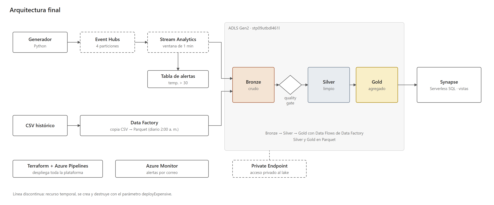

# Proyecto 09 · Plataforma de Datos con Data Lake y Procesamiento en Tiempo Real en Azure

Universidad Tecnológica de Bolívar · Infraestructura para TI (NRC 1216)
Equipo: Santiago Payares González, Juan David Malambo López, Cristian Benítez, Matteo Reyess
Profesor: Rafael Enrique Monterroza Barrios

Plataforma de datos sobre Azure con **arquitectura Lambda** (ruta streaming y ruta batch) y **capas Medallion** (Bronze / Silver / Gold) en ADLS Gen2. Las dos rutas aterrizan primero en Bronze y pasan por un *quality gate* antes de llegar a Silver y Gold. Synapse Serverless consulta el resultado. Toda la infraestructura está en Terraform y se despliega con Azure Pipelines, con aprobación manual.



## Componentes

| Área | Recurso (grupo `rg-p09utb-data`) | Archivo |
|---|---|---|
| Data Lake | `stp09utbdl461l` (ADLS Gen2, contenedores bronze/silver/gold/synapse, lifecycle 90 d → Cool y 365 d → Archive) | `terraform/main.tf` |
| Storage auxiliar | `stp09utbaux461l` (tabla `alertas`, contenedor `origen`) | `terraform/main.tf`, `terraform/adf.tf` |
| Streaming *(temporal)* | Event Hubs `evh-p09utb-461l` (hub `telemetria`, 4 particiones, retención 7 d) y Stream Analytics `asa-p09utb` (ventana tumbling de 1 min) | `terraform/streaming.tf` |
| Batch | Data Factory `adf-p09utb-461l`: `pl_batch_medallion` y `pl_streaming_medallion` | `terraform/adf.tf`, `terraform/streaming_medallion.tf` |
| Consumo | Synapse `syn-p09utb-461l` (Serverless, base `p09utb`) | `terraform/synapse.tf`, `sql/synapse_vistas.sql` |
| Seguridad | Roles RBAC por contenedor; Private Endpoint *(temporal)* | `terraform/seguridad.tf`, `terraform/red.tf` |
| Monitoreo | Log Analytics, alertas de métricas, grupo de acciones y presupuesto | `terraform/monitor.tf` |
| CI/CD | Azure Pipelines: validate → plan → apply, con OIDC y sin secretos | `azure-pipelines.yml` |

*Temporal* = se crea y se destruye con el parámetro **deployExpensive** del pipeline. Por defecto está apagado para no generar costo por hora.

## Estructura del repositorio

```
azure-pipelines.yml        Pipeline de infraestructura (validate → plan → apply)
terraform/                 Código Terraform (backend remoto azurerm, azurerm ~> 4.0)
src/generator/             Generador de telemetría IoT para Event Hubs (Python)
scripts/generar_csv.py     Genera el CSV sintético del batch
scripts/generar_csv_malo.py  Genera un CSV con 40 % de nulos para probar el quality gate
data/telemetria_batch.csv  Lote batch sano (1 020 filas)
sql/synapse_vistas.sql     Base, credencial, data source, vistas y 3 consultas de Synapse
docs/GUIA_DESPLIEGUE.md    Pre-requisitos, preparación, despliegue, uso, pruebas y destrucción
docs/diagramas/            3 diagramas (SVG editable + PNG) y su generador
docs/evidencia/            Evidencias en texto (p. ej. alertas.json)
```

## Inicio rápido

1. Completa los pre-requisitos y la preparación de [docs/GUIA_DESPLIEGUE.md](docs/GUIA_DESPLIEGUE.md): estado remoto, Service Connection con OIDC, environment `production` y variable secreta.
2. Crea una rama, haz cambios en `terraform/` y abre un Pull Request. El pipeline corre `validate` y `plan`.
3. Haz merge a `main` y aprueba el `apply` en el environment `production`.
4. Ejecuta `sql/synapse_vistas.sql` en Synapse Studio, bloque por bloque.
5. Lanza `pl_batch_medallion` desde Data Factory (*Trigger now*) y consulta las vistas.

## Notas

- **No se usó Ansible.** Toda la configuración de infraestructura es Terraform. El script SQL de Synapse se ejecuta a mano.
- **Ningún secreto vive en el repositorio.** La contraseña de admin de Synapse es la variable secreta `TF_VAR_synapse_admin_password` de Azure DevOps. `tfplan`, `*.tfstate` y `*.tfvars` están en `.gitignore`.
- Desviaciones respecto a la propuesta: Silver/Gold en Parquet (no Delta), sin Dedicated SQL Pool, RBAC por contenedor en lugar de ACL POSIX y un Private Endpoint con el acceso público aún habilitado. La justificación está en el documento final.
